# Technical note: what it is built with, how it works, and why

## 0. What this system is built with

| Layer | Choice | Used for |
|---|---|---|
| Framework | **Flutter 3.47.2 / Dart 3.13.2**, `material_ui` 1.10 (Material 3 Expressive widgets) | One codebase; Android is the primary target, iOS runs on the simulator. |
| State | **Riverpod 3.5** (`flutter_riverpod`, `Notifier`/`AsyncNotifier`, no code generation) | Live streams become `AsyncValue`s; controllers hold form and action state; `ref.listen` drives side effects. |
| Navigation | **go_router 18** (`StatefulShellRoute`, `redirect`) | Five tabs with their own back stacks; a pure `redirectFor(session, location)` gates auth. |
| Backend | **Firebase Auth** (email + password, phone index for phone login) and **Cloud Firestore** (transactions, `snapshots()` streams, security rules) | Real accounts and persisted sessions; every screen is live; the request limit and bid acceptance are atomic. |
| Device settings | `shared_preferences` | Language and appearance, kept on the phone. |
| Localisation | `flutter_localizations`, `intl`, `flutter gen-l10n` (ARB → `AppLocalizations`) | English and Nepali for every string, including validation and error messages. |
| Other | `url_launcher` (call the carrier), Inter typeface (OFL) | |
| Tests | `flutter_test` with an `AppHarness` that runs the whole app over `fake_cloud_firestore`; `flutter_lints` | 161 tests: rules, repositories, journeys, layout sweeps, appearance and language. The same harness renders the documentation screenshots. |
| Tooling | Firebase emulators for local runs (`--dart-define=USE_FIREBASE_EMULATORS=true`), `firestore.rules` deployed to the project | |
| Assistance | Claude Code, declared in the README | Scaffolding, UI iteration, tests and documentation, reviewed and decided by the author. |


## 1. Architecture

Feature-first clean architecture, kept to three layers: every feature has
`domain/`, `data/` and `presentation/`, and every dependency points inward,
toward the feature's pure domain.

```
lib/
  main.dart, app.dart     start-up (Firebase, ProviderScope) and the MaterialApp
  routing/                router, auth redirect, tab shell (composes screens)
  core/                   feature-agnostic foundation
    errors/               AppException types (pure Dart)
    utils/                formatters, validators (pure Dart)
    firebase/             Firestore instance, schema names, strict readers,
                          guard (timeouts) and Firebase → AppException mapping
    theme/ widgets/       UI kit
    constants/ platform/  locations; phone/URL launchers
  features/<feature>/
    domain/               models, repository contract, business rules
    data/                 Firebase repository + mapper; providers.dart is
                          the feature's composition root
    presentation/         screens, widgets and their Riverpod state
```

| Feature | domain | data | presentation |
|---|---|---|---|
| auth | `UserProfile`, `AuthUser`, `AuthRepository` | Firebase Auth | login, register, verify, splash; `Session` state |
| account | `AccountRepository` | profile, phone index, drafts, sample data | account, edit profile, help |
| shipments | `Shipment`, statuses, cargo, request limit, filters | shipments, sample data | list, details, cards, limit sheet; shipments stream |
| bids | `Bid`, bid rules | bids | bids, offer details, accept flow; simulated bids |
| tracking | `LivePosition`, simulated driver | live positions | tracking screen; live position + driver |
| create_shipment | draft + validation | draft mapping | form, review, posted; Post Load controller |
| analytics, notifications | analytics, activity feed | | screens, in-app alerts |
| dashboard | | | Home |

**Rules** (enforced by `test/architecture_test.dart`, which lists any
offending `file → import`):

```
 presentation ──► domain ◄── data
```

- **domain is pure Dart.** It imports only other domain code and core's
  errors and utils: no Flutter, no Firebase. The request limit, draft
  validation, bid rules, filters, analytics, tracking and the simulated
  driver are tested without widgets or a database.
- **Inward only.** data never imports presentation.
- **Data internals are private.** Outside data, the only data file anyone
  imports is a feature's `data/providers.dart`, so every repository is
  reached through its domain contract. Data layers may share the Firestore
  schema, because one transaction can span collections (accepting a bid
  updates the shipment and its bids together).
- **Screens are private.** A feature may use another feature's domain,
  state and widgets (bids show a shipment's status badge; Home reads the
  shipments stream), but never its screens: navigation goes through routes.
- **core is feature-agnostic**, and only data layers, `core/firebase` and
  start-up import Firebase.

**Shared entities.** Features depend on each other only through domain
models and presentation state, never through implementations. `Shipment`
is owned by `shipments`, and the other features import it from there.

## 2. Data flow

```
 Widgets (screens)
   │ ref.watch(...)                          ▲ AsyncValue / Session
   ▼                                         │
 Riverpod providers & controllers ───────────┘
   │ authUserProvider ─┐
   │ profileProvider ──┴─► sessionProvider ──► router redirect (redirectFor)
   │ shipmentsProvider (live, per user) ← single source of truth
   │   ├─ shipmentSummaryProvider     dashboard tiles
   │   ├─ filteredShipmentsProvider   list: search + filter + sort
   │   ├─ shipmentByIdProvider(id)    details, tracking, confirmation
   │   ├─ requestLimitUsageProvider   limit meter / warnings
   │   └─ activityFeedProvider ◄── shipperBidsProvider   notifications, alerts
   │ bidsProvider(shipmentId)            bids, offer details
   │ livePositionProvider(shipmentId)    tracking, Home, details (live reports)
   │ CreateShipmentController            draft, steps, save/restore, submit
   │ ShipmentActionsController(id)       cancel, accept bid, simulated carrier events
   ▼
 Repository contracts (features/*/domain/*_repository.dart)
   ▼
 Firebase implementations ── transactions ──► Firestore      Firebase Auth
                         ◄── snapshots() live streams          (sessions persist)
```

- **Reads are streams.** Every shipment-derived value comes from one
  per-user snapshot stream, passed through pure domain functions.
  After any write, Firestore pushes a new snapshot and every screen updates,
  with nothing to refresh by hand.
- **Writes are commands.** Controllers call repository methods that run
  Firestore transactions. Success is shown only after the server commits;
  buttons show progress and ignore repeat taps.
- **The session drives navigation.** Auth state and the profile document
  combine into one `Session` value. `redirectFor(session, location)` is a
  pure function, so routing and auth can't disagree, and it is unit-tested.
  Each tab keeps its own back stack (`StatefulShellRoute`). Detail screens
  live under their tab, but the posting flow (`/post-load`, `/posted/:id`)
  is top-level, so returning to a tab never reopens a finished flow.
- **Errors are typed.** Firebase Auth and Firestore errors map to
  `AppException`s with user-safe messages. Writes time out after 15 s, so a
  queued offline write never hangs the UI.

## 3. Repository design

Each feature's `domain/` declares its repository contract; together they
describe business operations rather than CRUD:

- `AuthRepository`: sign in, create account, reset password, verify email,
  sign out.
- `AccountRepository`: profile, phone index, sample data, drafts,
  notifications-seen, feedback.
- `ShipmentRepository`: watch, create (limit + reference), cancel, carrier
  update.
- `BidRepository`: watch, accept (atomic, idempotent), simulate bids.
- `TrackingRepository`: watch a shipment's live position, report the
  simulated driver's next position (skipped if another device just did).

Models are plain Dart in each feature's `domain/`; Firestore mapping lives
next to the repository in the feature's `data/` (`ShipmentMapper`,
`BidMapper`, ...), on top of strict field readers in `core/firebase`.
Malformed documents are skipped and their ids logged, so one bad record
can't break a list. Each feature's `data/providers.dart` is the only place
that names its concrete class.

## 4. Swapping in a REST backend

Implement the same contracts with HTTP in each feature's `data/` (for
example with `dio`):

- `createShipment` → `POST /shipments` with an `Idempotency-Key` equal to
  the request id.
- `acceptBid` → `POST /shipments/{id}/bids/{bidId}/accept`.
- `watchShipments` → SSE/WebSocket, or fetch plus refresh.

Map HTTP errors to the same exceptions: `409 LIMIT_REACHED` →
`RequestLimitReachedException`, `401` → sign-out, `5xx`/timeouts →
`NetworkException`. Then point each feature's `data/providers.dart` at the
new class. No screen changes, because screens only see `AsyncValue`s and `AppException`s,
and the architecture test guarantees no screen imports Firebase.

## 5. Decisions and trade-offs

| Decision | Why | Cost / mitigation |
|---|---|---|
| Firebase Auth email/password + phone index | Real accounts, persisted sessions, real reset/verification emails; phone login as in the mockups. | The phone→email lookup is a public `get`; production replaces it with phone OTP. |
| Per-user security rules | Each shipper can only see their own data; role and email are immutable. | Bids are client-written in this build (simulation); production moves that to carriers. |
| Counter document for the limit | Transactions can't query; a counter makes check-and-increment atomic; rules cap it at 3. | It can drift, so it is re-derived at each sign-in. Production moves this server-side. |
| Client-generated shipment id as idempotency key | A retry after a lost response returns the original shipment. | A changed draft gets a new key (it's a different request). |
| Drafts on the account (`users/{uid}/drafts/current`) | Nothing typed is lost: survives closing, restarts and switching device. | One draft per user, which matches the single Post Load flow. |
| Simulated carrier marketplace | Lets a single user experience the whole lifecycle: bids arrive, booking, tracking, delivery. | Clearly labelled, idempotent, runs only while the app is open. |
| Activity feed derived, not stored | Can't disagree with shipments; unread state is one timestamp. | Feed size grows with history; production would page or store events. |
| Client-side expiry and sample refresh at sign-in | A request past its pickup must free its slot, and a demo account opened days later should still make sense. Both are idempotent, and sample data is only refreshed if untouched. | Only runs when the app opens; production moves expiry to a scheduled server job. |
| Material 3 Expressive theme | Tonal colours generated from the brand orange (the same algorithm Android uses for dynamic colour), so tonal buttons, chips, the raised Post load button and status badges all match; shared components (cards, top bar, segmented list) carry the look, so screens stay consistent. | A few Expressive components (button groups, wavy progress) aren't in this Flutter version; their look is built from standard widgets. |

## 6. Discussion prep

- **Limit in production:** callable Cloud Function or API endpoint running
  the create transaction with the Admin SDK; rules deny direct writes; the
  request id is the idempotency key; a scheduled job handles expiry.
- **Accept fails or times out:** the transaction is all or nothing. The app
  says the offer "hasn't been accepted yet" and that retrying is safe; a
  retry of the same bid is a no-op if it already committed, and the live
  stream shows the truth.
- **Duplicates:** buttons and controllers block re-entry while in flight;
  creation is idempotent by id; a second, different accept is refused inside
  the transaction (Firestore retries the losing transaction, which then
  fails cleanly).
- **Pagination, tokens, offline:** cursor pagination on
  `shipperId, createdAt`; the Auth SDK refreshes tokens, and the session
  stream signs the user out if the token is revoked; the Firestore cache
  serves stale data offline while writes fail fast with a clear message.
- **Tests (161):** the architecture rules; domain rules (limit,
  validation, filters agree with counts, activity feed, tracking, the
  simulated driver); Firebase error mapping; repositories on
  `fake_cloud_firestore`
  (limit, unique references, idempotent create/accept, duplicate refusal,
  lifecycle, owner-filtered queries); auth and account (registration
  rollback, phone sign-in, reset that reveals nothing, phone re-index,
  drafts, unread); widgets (login validation and sign-in, list filter and
  search); end-to-end journeys through the real router and screens (sign-out
  and phone login, accepting a bid, the limit block, disabled past times);
  and a layout sweep of every screen at 320×568 with ×1.3 text and 360×640
  with ×1.6 text; appearance and language switching on live screens.
  **Next:** emulator-backed tests of the security rules and golden tests
  for key screens.

## 7. Appearance and language

Both are device settings (`shared_preferences`, `core/settings/app_settings.dart`),
not account data: they describe the phone in hand.

**Dark mode.** Screens read colours from `AppColors` statically, which kept
hundreds of call sites untouched. `AppColors` is now a set of getters over a
light and a dark palette, selected by `AppColors.brightness`. Because a
static read creates no inherited-widget dependency, changing it would leave
widgets showing their old colours; the app therefore marks the whole element
tree dirty once when the setting changes (`_applyPalette` in `app.dart`).
That is one full rebuild per switch, which is acceptable for a settings
change, and it is covered by `test/features/appearance_test.dart`.

**Nepali.** Strings live in `lib/l10n/app_en.arb` and `app_ne.arb`; `flutter
gen-l10n` generates `AppLocalizations`. Widgets and domain code alike read
`l10n` from `core/l10n/strings.dart`, a context-free accessor keyed on
`AppLanguage.current`, so validators, enum labels and repository messages are
translated too. The same forced rebuild applies on a language change. Material
widgets get Nepali from `material_ui`'s own `GlobalMaterialLocalizations`
(this project uses `package:material_ui`, whose `MaterialLocalizations` type
differs from `flutter/material`'s). Text written to Firestore (timeline
notes) stays English because it is data, not UI.

## 8. Features, with screenshots

Frames are rendered by `flutter test test/docs_screenshots_test.dart
--dart-define=SCREENSHOTS=true` over the brief's sample data.

### Sign in and accounts

| | |
|---|---|
| 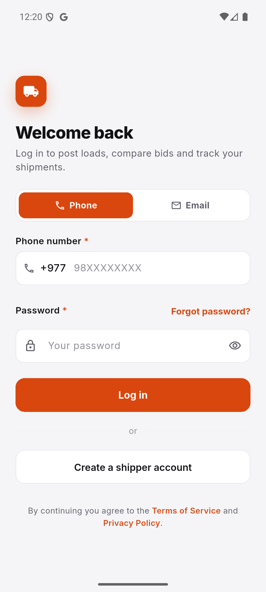 | 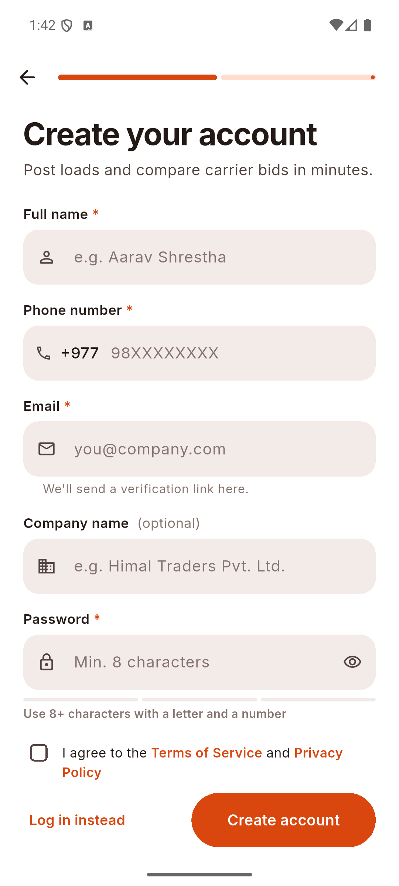 |

One field accepts an email or a Nepali mobile number; a phone number is
resolved to the account's email through `phoneIndex/{phone}` and signed in
with Firebase Auth. Registration creates the auth account and the
`users/{uid}` profile together; if the profile write fails the auth account
is removed so the email can be reused. Email verification is encouraged,
not forced. Only `shipper` accounts may use the app (checked after sign-in,
enforced by rules).

### Home

| | |
|---|---|
| 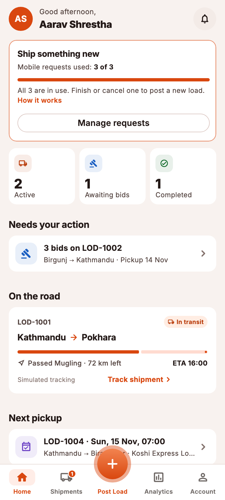 | 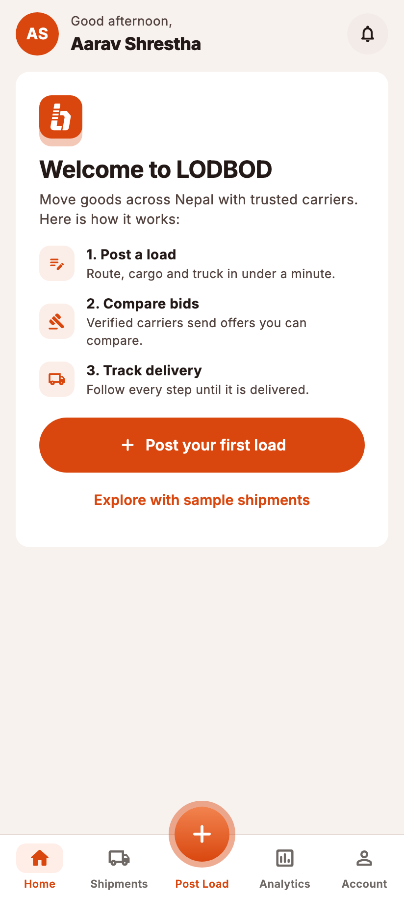 |

Everything on Home derives from one live `shipmentsProvider` stream: the
mobile-request meter, Active / Awaiting bids / Completed tiles (each opens
the list pre-filtered), *Needs your action* (loads with offers to review),
*On the road* (live progress), *Next pickup*, and other shipments. A new
account sees a three-step welcome and can load the sample data set.

### Shipments and details

| | |
|---|---|
| 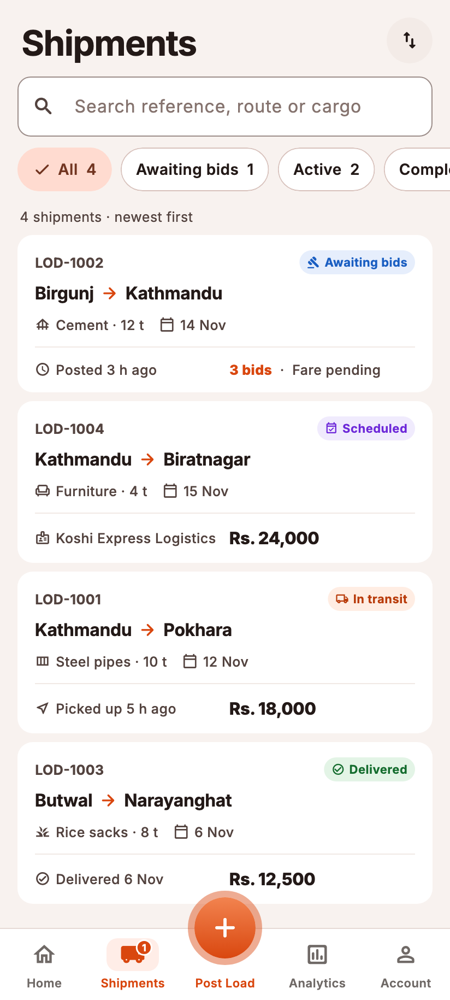 | 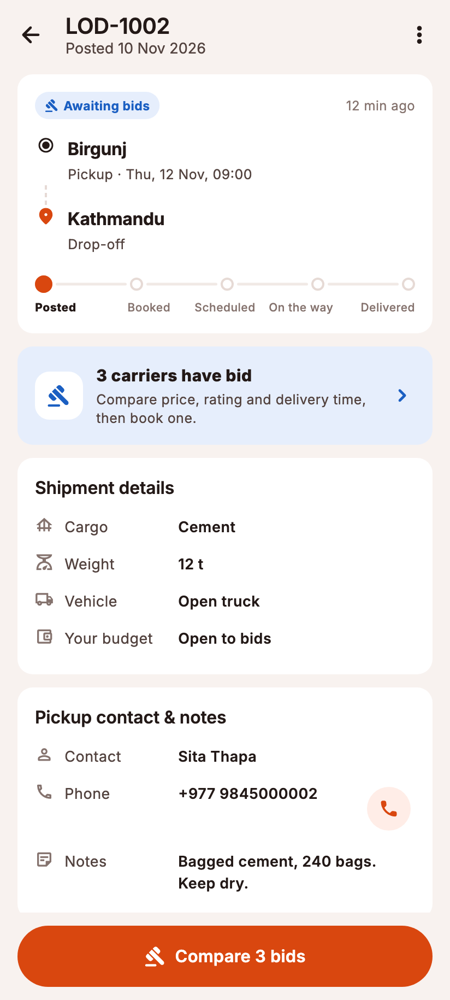 |

Search matches reference, route and cargo; status chips carry counts; sort
by newest, pickup date or status. Details show the route, a five-step
lifecycle stepper, a context card that changes with status (bids waiting,
carrier booked, cancelled), cargo and contact details with a call button,
and the stored activity log. The primary action follows the status:
*Compare bids*, *Track shipment*, *Post a similar load*.

### Bids and booking

| | | |
|---|---|---|
| 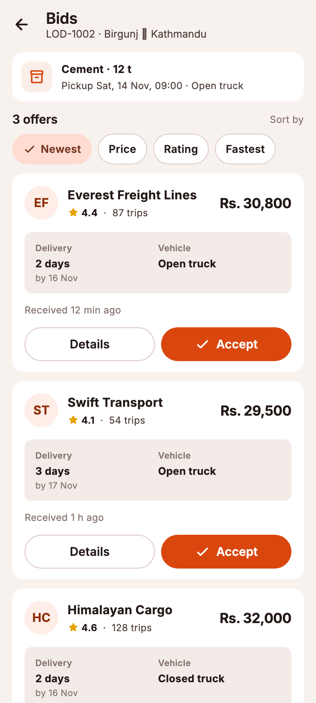 | 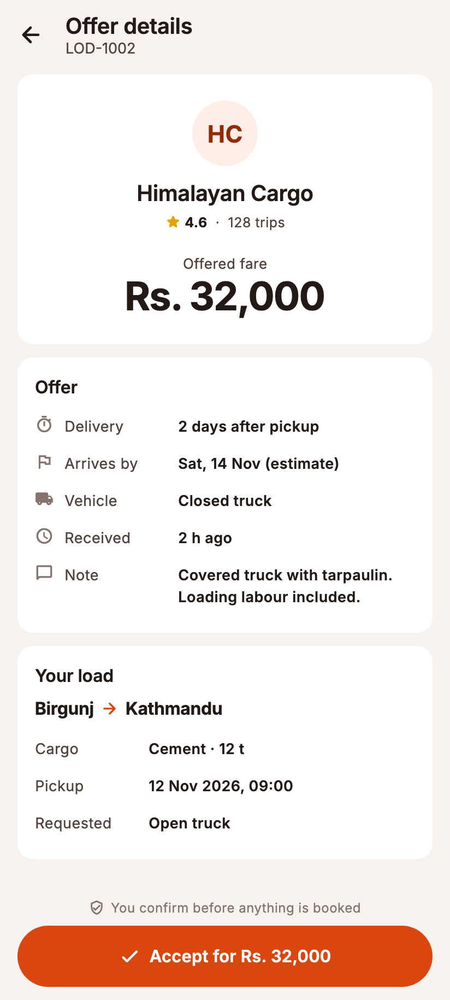 | 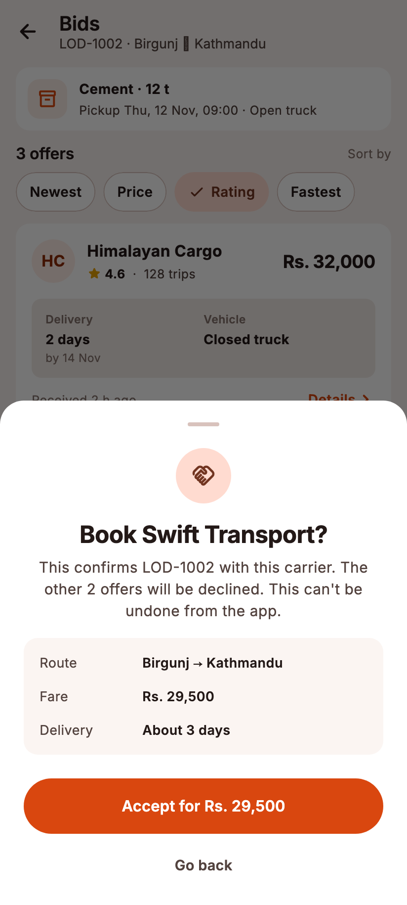 |

Offers show the same fields in the same places so they compare at a glance;
nothing is labelled "best". Sorting is the shipper's choice. Accepting runs
one Firestore transaction that confirms the shipment, records carrier, fare
and ETA, accepts this bid and declines the others; retrying the same accept
is a no-op, a second different accept is refused. The UI only shows
"Booked" after the server commits.

### Posting a load

| | | |
|---|---|---|
| 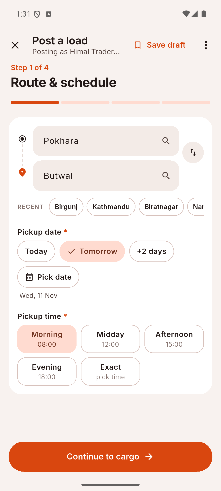 | 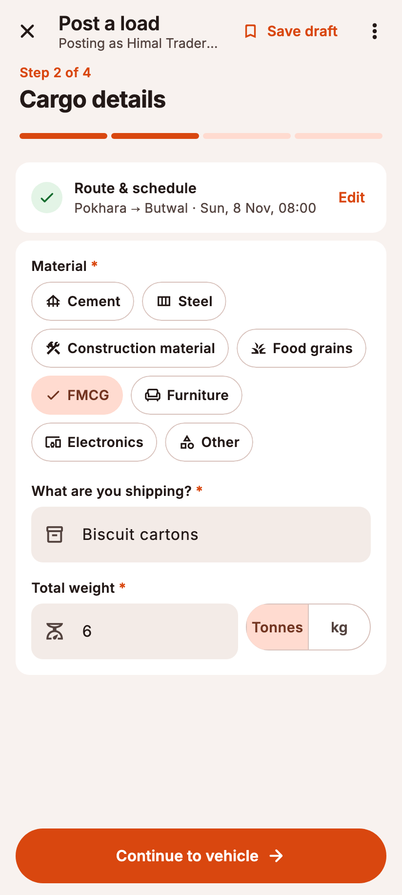 | 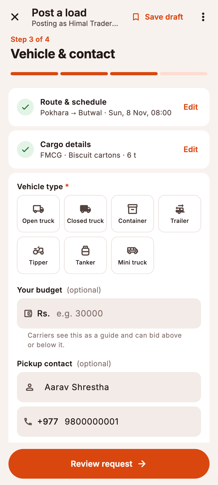 |

| | | |
|---|---|---|
| 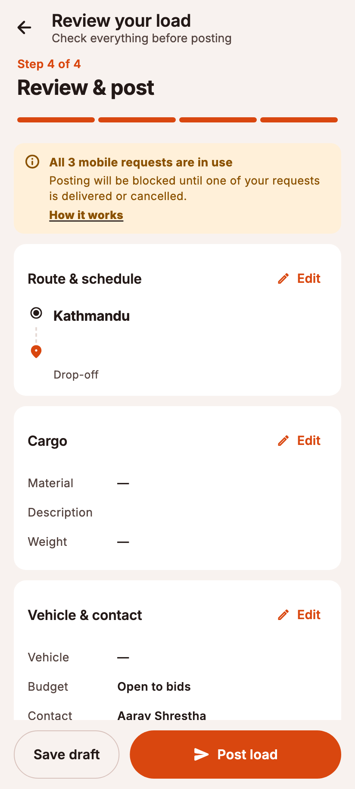 | 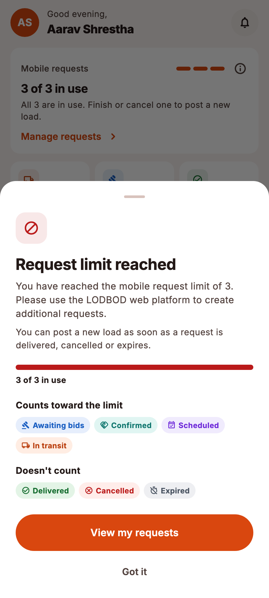 | 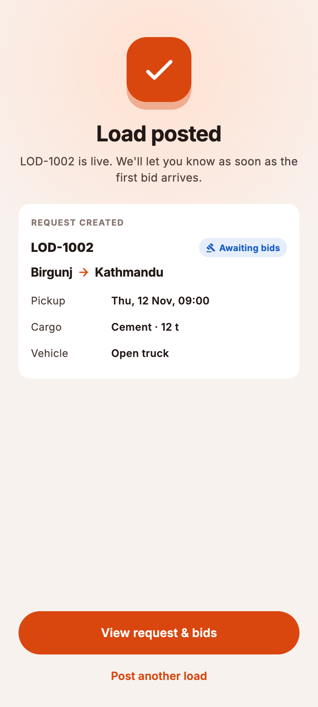 |

Three short steps and a review. Every rule lives in `ShipmentDraft.validate`
(pure Dart, unit-tested): pickup and destination required and different,
weight positive, pickup date today or later with time slots that have
passed disabled. The draft survives closing the form, restarts and other
devices (`users/{uid}/drafts/current`). The three-request limit is checked
when Post Load opens, again on submit, and finally inside the create
transaction, which also allocates the unique `LOD-n` reference; the client
request id makes a retry after a lost response idempotent. At the limit the
prescribed message appears and nothing typed is lost.

### Tracking

| | |
|---|---|
| 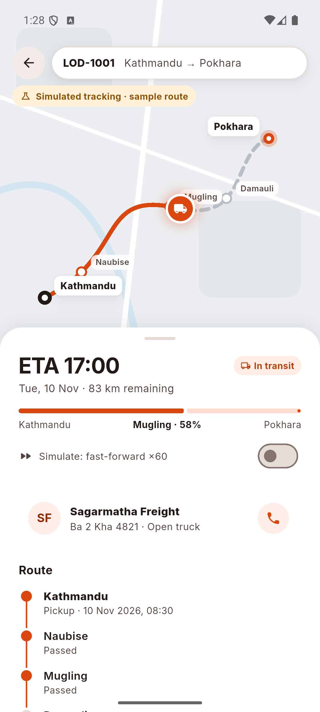 | 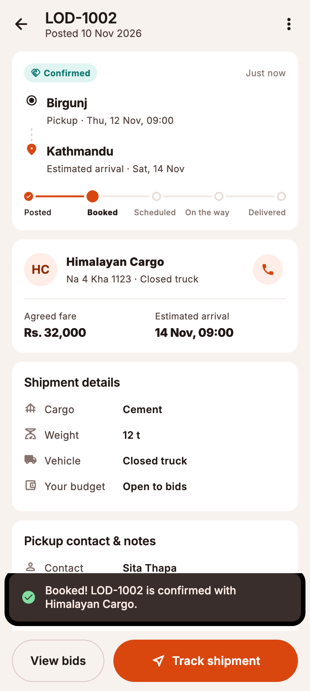 |

A stylised route map with checkpoints, ETA and distance remaining, the
carrier card with a call button, and the stop list. Position reports come
from a simulated driver written to `tracking/{shipmentId}` so every device
watching sees the same truck; without reports the position is estimated
from the schedule. Both states say "simulated".

### Notifications and analytics

| | |
|---|---|
| 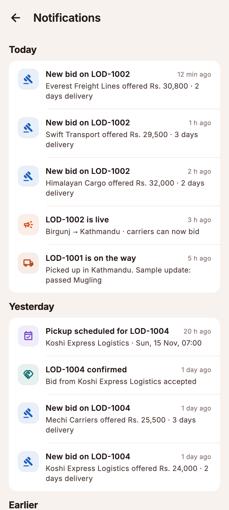 | 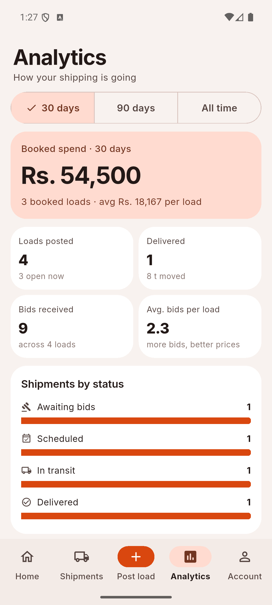 |

The feed is derived from shipment timelines and bids, so it can never
disagree with them; unread state is one timestamp. In-app toasts appear for
new bids and delivery updates while the app is open. Analytics (30 / 90
days / all time) are computed from the same list: booked spend, loads
posted, bids received, shipments by status, top routes.

### Account and preferences

| | | |
|---|---|---|
| 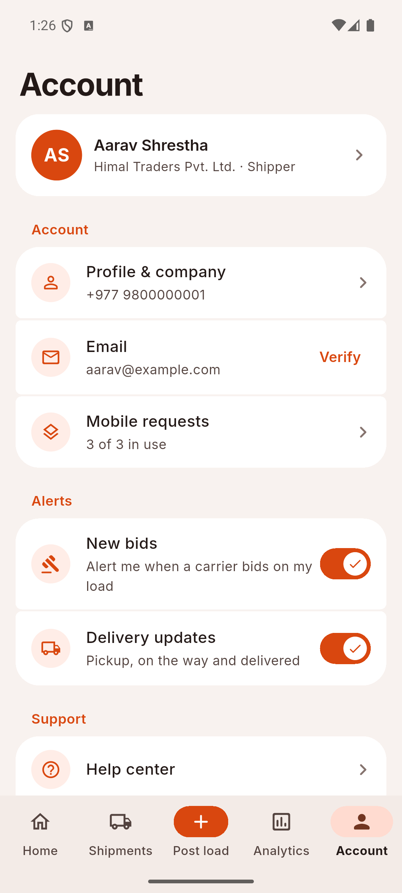 | 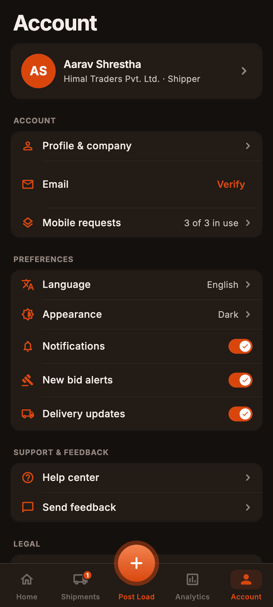 | 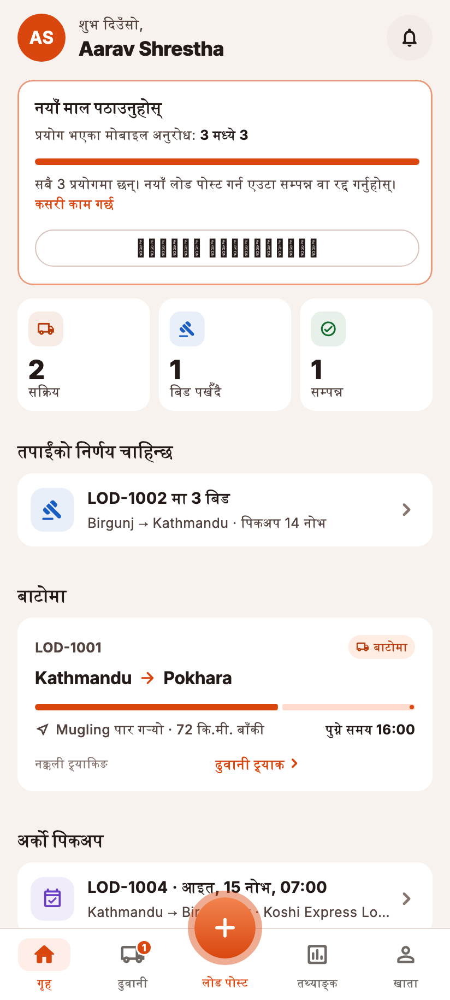 |

Profile and company, email verification, request usage, help centre, send
feedback (stored in Firestore), legal summaries, sample data, sign out.
Preferences: **Language** (English / नेपाली), **Appearance** (System /
Light / Dark) and **Notifications** with per-kind switches; see section 7 for
how the palette and strings switch at runtime.

